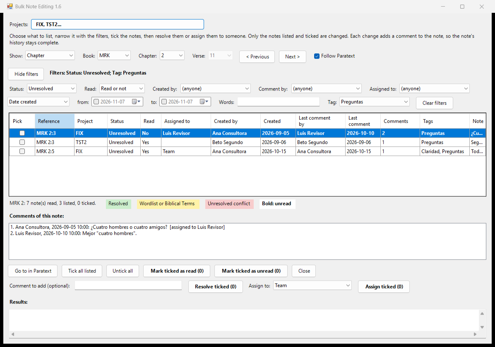

# Bulk Note Editing

*This page is the English user guide, [BulkNotes_UserGuide.rtf](plugin/BulkNotes_UserGuide.rtf). The guide is also available in Spanish ([BulkNotes_UserGuide_sp.rtf](plugin/BulkNotes_UserGuide_sp.rtf)) and French ([BulkNotes_UserGuide_fr.rtf](plugin/BulkNotes_UserGuide_fr.rtf)).*

## Purpose

Bulk Note Editing is a Paratext plugin for handling many project notes at once. It lists the notes of a verse, a chapter, a whole book or the whole project, of one project or several together, lets you narrow the list with filters (status, read or not, who wrote the note, who commented, who it is assigned to, dates, words, tag), and resolves or assigns all the notes you tick in one step.

This tool is experimental. Try it first on a project where a mistake does no harm.

Notes cannot be deleted with this tool: Paratext does not let plugins delete notes.

## Installing

1. Download Install_Phils_tools.exe from the Paratext_Plugins folder. If your browser warns about the file, choose to keep it.

2. Close Paratext.

3. Double-click Install_Phils_tools.exe. If Windows says it protected your PC, click "More info", then "Run anyway" (the installer is not signed yet).

4. Tick Bulk Note Editing (experimental) and click "Install / update ticked". It installs into every Paratext 9 on the computer. If Windows asks for permission, click Yes. The same window updates the plugin later (its status then says "Update available") or removes it ("Remove ticked"), and its "User guide" button opens this guide.

## How to use

1. Open the project and choose Tools > Bulk Note Editing... The window opens at the book, chapter and verse you are looking at. "Projects" names the projects listed: click it to tick several projects and list their notes together; a Project column then shows where each note is. The same book, chapter and verse are read in each project. The tool remembers the projects you ticked, and always adds the project you start it from.

2. In "Show", choose Verse, Chapter, Whole book or Whole project, then the book, chapter and verse. "< Previous" and "Next >" move by verse, chapter or book. A large project can take a moment to read as a whole. With "Follow Paratext" ticked, the window moves to the place you go to in Paratext. A note on a range of verses (for example MRK 2:10-12) is listed at each of its verses.

3. Narrow the list with the filters:
   - Status: Unresolved (the default), Resolved or All.
   - Read: Read or not (the default), Unread or Read, for you. With Status Resolved and Read Unread, the list shows the notes that were resolved but that you have not read yet. A note counts as read once you have opened it in Paratext's Notes window, or marked it read with this tool (step 8). Notes you resolve or assign with this tool are marked read too.
   - Created by: the person who wrote the note (its first comment).
   - Comment by: anyone who wrote any comment of the note.
   - Assigned to: a person, Team, or (nobody).
   - Dates: tick "from" and/or "to" to limit the date the note was created, or the date of its last comment.
   - Words: notes with these words in any comment, or attached to these words.
   - Tag: notes with this tag. The list has the project's tags, then Paratext's own: Conflict (the notes Send/Receive makes when two people changed the same verse), Spelling and Biblical term. A note with no tag counts as To Do, as in Paratext. With several projects, a tag is found by its name, because each project numbers its own tags.

"Clear filters" removes them all. Click a column heading to sort by that column; click again to reverse the order.

"Hide filters" hides the filter boxes to leave more room for the list; "Show filters" brings them back, and the tool remembers your choice. The line beside the button always says which filters are in effect.

Colours in the list: unresolved conflict notes are light red; notes made in the Wordlist or in Biblical Terms are yellow; other resolved notes are light green. Notes you have not read are in bold, and the Read column says Yes or No. A key below the list shows the colours.

4. Click a note to see all its comments below the list. "Go to in Paratext" (or a double-click) shows the verse in Paratext.

5. Tick the notes to change, or click "Tick all listed".

6. If you want, type a comment in "Comment to add". It is added to each note.

7. Click "Resolve ticked", or choose a person in "Assign to" and click "Assign ticked". "Assign to" offers Team, the people still active in the project (users whose role in Paratext's list of project users is not None) and (nobody). With several projects it offers anyone active in at least one of them: a note in a project where that person is not active is left as it is and listed in Results. The tool asks before it changes anything.

8. "Mark ticked as read" and "Mark ticked as unread" mark the ticked notes as read or unread for you, without adding a comment. Only your own read status changes: Paratext keeps it on your computer, outside the project, and does not share it by Send/Receive, so it works even where you are an observer. It uses a part of Paratext that is not officially offered to plugins: if your version of Paratext does not allow it, nothing is changed and Results says so. Paratext's Notes window may show the change only after you open it again.

## What happens

- Only notes that are listed and ticked are changed. Notes hidden by a filter are never changed.
- Resolving adds a "resolved" comment to the note, under your name, as Paratext does. Your comment, if you typed one, comes just before it.
- Assigning adds a comment that assigns the note. Without a comment of yours it says "Assigned to ...". Choose (nobody) to remove the assignment.
- A note you resolve or assign is marked as read for you, its new comment included: you must have read it to decide. Notes that needed no change keep their read status.
- Notes that need no change (already resolved, or already assigned to that person) are left as they are and listed in Results.
- After the change the tool reads the notes again and lists any note Paratext did not change, so you can check it.
- If you are an observer of the project, the notes are listed but the buttons are off.
- With several projects, each project is changed on its own: if one cannot be changed (for example because you are an observer there), the others still are.
- Nothing is lost: every change is a new comment, so the note's history stays complete. A resolved note can be opened again in Paratext.

The notes go through Paratext itself, so they are shared by Send/Receive like any other change to notes.
